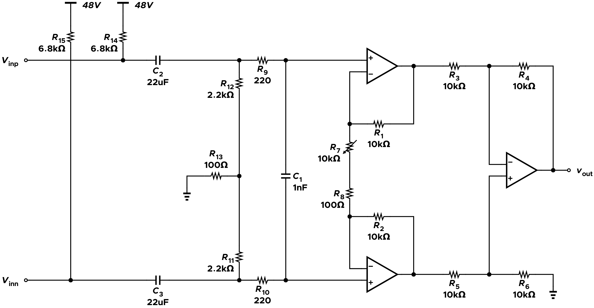
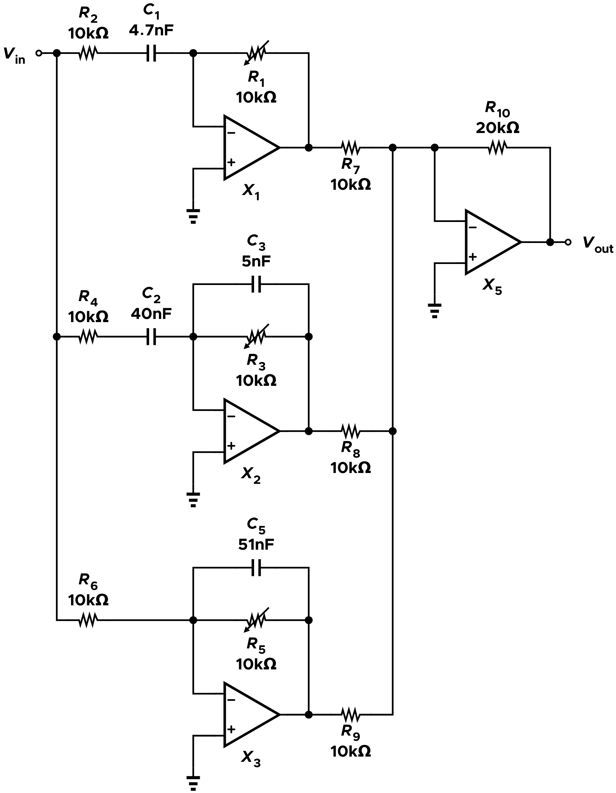
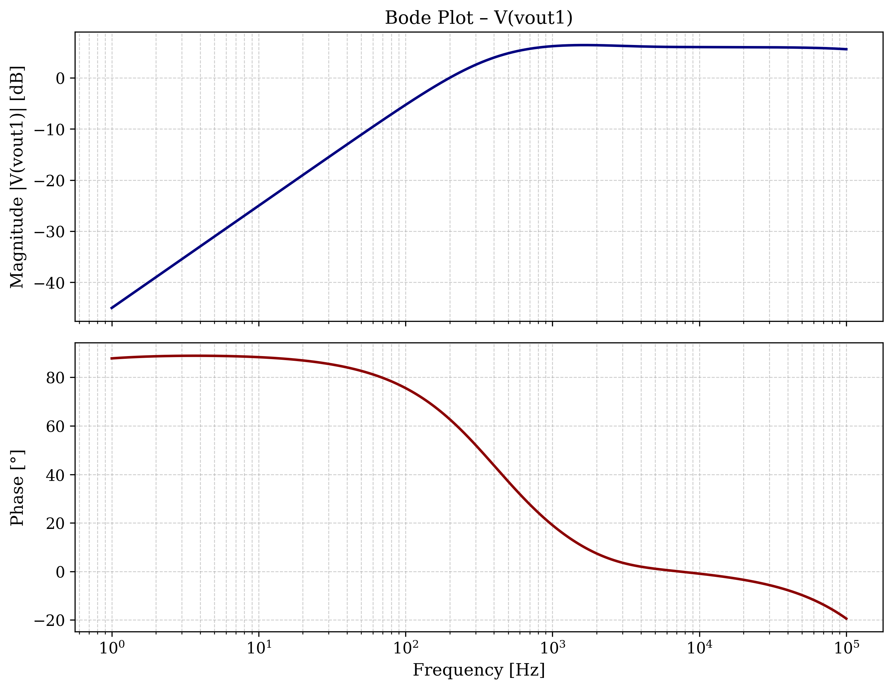
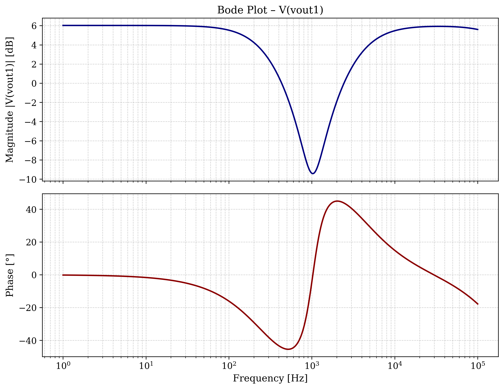
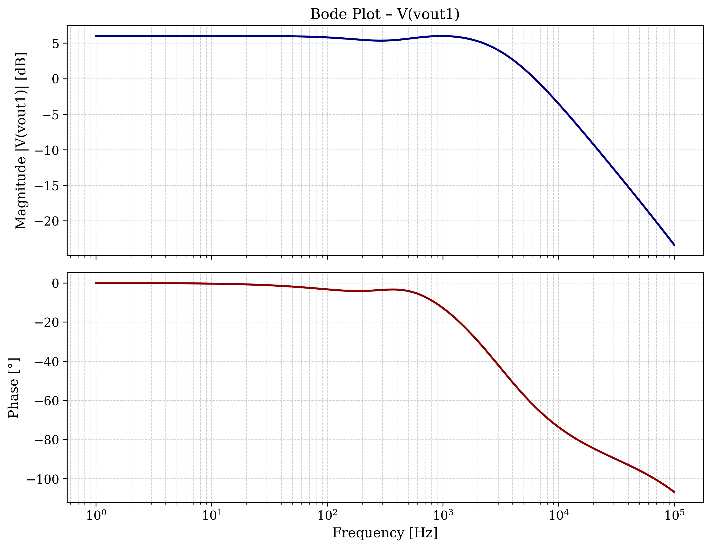
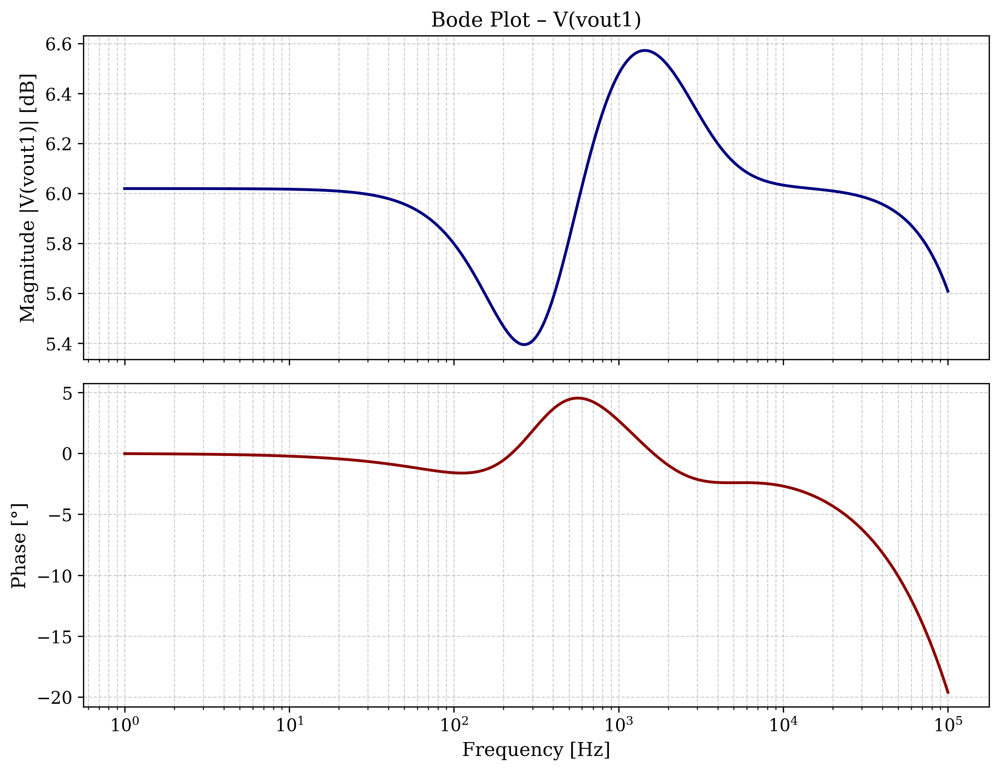
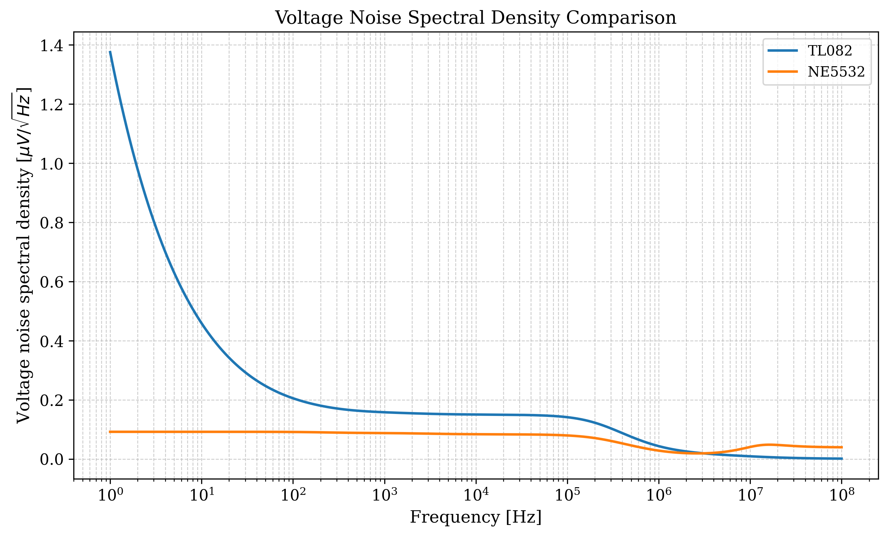
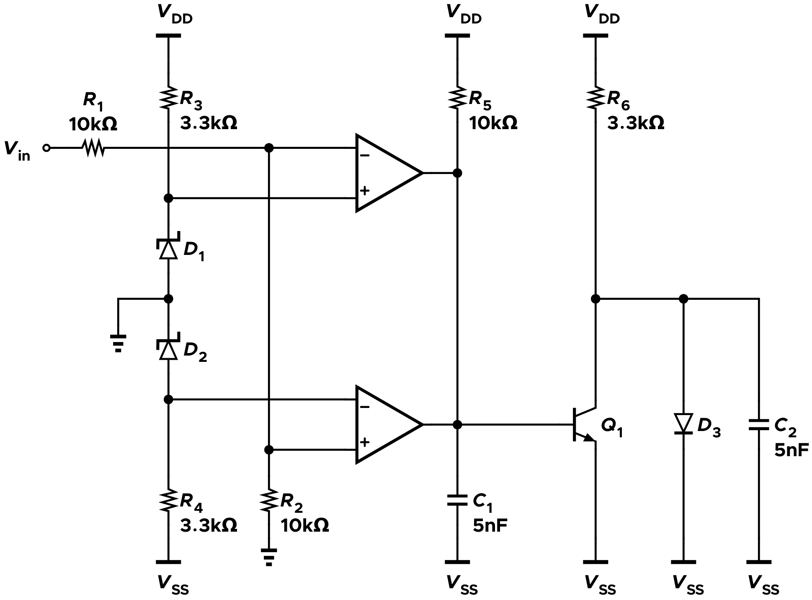

# Analog Audio Mixer

<p align="left">
  
  
  
</p>

## Overview

Design and development of a **modular analog audio mixer**, combining circuit simulation and PCB design. The project focuses on audio signal conditioning, equalization, level control, and the integration of multiple input channels into a modular mixer architecture.

The design is divided into two main development areas:

- **LTspice simulations:** individual analog circuit blocks are simulated and evaluated before hardware implementation.
- **KiCad designs:** modular PCB boards are developed to organize the mixer circuitry into functional sections.

The current design includes microphone/line signal conditioning, a three-band equalizer, level and FX-send circuitry, a clipping indicator, and a four-channel mixer board.

The project is still under development. Circuit design, simulation, and PCB integration are ongoing, and the current files should be considered work in progress rather than a finalized hardware design.

## System Architecture

The mixer is organized into modular functional blocks. This approach makes it possible to develop and test each section independently before integrating the complete system.

### 1. Input Signal Conditioning

The input stage provides microphone and line-level signal conditioning. Separate configurations are included for a single microphone/line channel and for two line-level channels, intended for left and right stereo signals.

The signal-conditioning section includes:

- Microphone/line preamplification.
- Three-band tone control.
- Output-level adjustment.
- FX-send circuitry.

The modular structure allows the input circuitry to be adapted to different channel configurations.



### 2. Three-Band Equalizer

The three-band equalizer provides independent control over the low-, mid-, and high-frequency portions of the audio spectrum.

The frequency response is evaluated through LTspice AC analysis. Different equalizer settings are compared to investigate how the circuit affects the audio signal across the frequency range.



## Design and Simulation

LTspice is used to investigate the behavior of the individual circuit blocks. The simulations currently focus on frequency response, signal conditioning, and noise performance.

### 1. Three-Band Equalizer Response

The following Bode plots show the equalizer response for different control settings.

| Low-frequency cut | Mid-frequency cut | High-frequency cut |
|:---:|:---:|:---:|
|  |  |  |

The following plot shows the overall frequency response with all equalizer bands set to their neutral position (flat response).



A Monte Carlo analysis was also performed, considering a **1% tolerance for resistors (0603 package)** and a **10% tolerance for ceramic X7R capacitors**.

The resulting frequency response is shown in the figure below, with no cutoff frequency applied.


### 2. Noise Analysis

Noise performance is an important aspect of analog audio design, particularly in microphone preamplifier stages, where low-level input signals must be amplified.

LTspice noise analysis is used to evaluate the output noise spectral density of the circuits. The results are also compared between different operational-amplifier configurations.

The current comparison is part of the ongoing investigation into the noise contribution of the amplifier stages and their component models.



The noise simulations are still being refined. In particular, the accuracy of the operational-amplifier noise models and their agreement with datasheet specifications require further verification.

### 3. Clipping Indicator

A dedicated clipping-indicator circuit is included in the LTspice project.

The circuit uses an LM393 comparator model to detect signal levels approaching the selected clipping threshold. The output can be used to drive an LED, providing a visual indication of excessive signal amplitude.



The comparator circuit is simulated separately to allow its operation and threshold behavior to be evaluated independently of the complete mixer.

## PCB Design

The PCB development is carried out in KiCad. The modular approach separates the main mixer board from the input signal-conditioning circuitry.

### 1. Four-Channel Mixer Board

The `4ChannelMixerBoard` project contains the PCB design and schematic for the four-channel mixer board.

The board is intended to provide the central platform for combining the individual audio channels.

### 2. Single-Channel Microphone/Line Board

The `SignalConditioning - OneChannel - Mic-Line` project contains the signal-conditioning design for a single microphone/line input channel.

The project includes the following schematic sections:

- Microphone/line preamplifier.
- Three-band equalizer.
- Level control and FX-send circuitry.
- Power supply.

### 3. Two-Channel Line Board

The `SignalConditioning - TwoChannels - R-L-Line` project contains a two-channel signal-conditioning configuration intended for right and left line-level signals.

Its schematic is organized around the same functional blocks as the single-channel version, adapted for a stereo input configuration.

The PCB layouts and circuit integration are still under development. Further work is required to complete the board designs and verify their operation in hardware.

## Repository Structure

```text
.
├── README.md
│
├── AudioMixer - LTSpice/
│   ├── 3bEq/
│   │   ├── AudioMixer - 3bEq.asc       # Three-band equalizer simulation
│   │   ├── NE5532.sub                  # NE5532 operational amplifier model
│   │   ├── noise_comparison.pdf        # Noise comparison plot
│   │   └── Montecarlo/                 # Monte Carlo simulation files
│   │
│   ├── ClippingLed/
│   │   ├── ClippingLed.asc             # Clipping indicator simulation
│   │   └── lm393.lib                   # LM393 comparator model
│   │
│   └── Mic-Line amplifier/
│       ├── AudioMixer - Mic-Line-amp.asc
│       └── NE5532.sub                  # NE5532 operational amplifier model
│
├── AudioMixer - ModularBoards/
│   ├── spec.txt                        # Project specifications
│   │
│   ├── 4ChannelMixerBoard/
│   │   ├── Mixer_circuit.kicad_pro
│   │   ├── Mixer_circuit.kicad_sch
│   │   └── Mixer_circuit.kicad_pcb
│   │
│   ├── SignalConditioning - OneChannel - Mic-Line/
│   │   ├── AudioMixer.kicad_pro
│   │   ├── AudioMixer.kicad_sch
│   │   ├── AudioMixer.kicad_pcb
│   │   ├── Mic-Line_preamp.kicad_sch
│   │   ├── 3_band_equalizer.kicad_sch
│   │   ├── Level_and_FXSend.kicad_sch
│   │   └── Power_supply.kicad_sch
│   │
│   └── SignalConditioning - TwoChannels - R-L-Line/
│       ├── AudioMixer.kicad_pro
│       ├── AudioMixer.kicad_sch
│       ├── AudioMixer.kicad_pcb
│       ├── Mic-Line_preamp.kicad_sch
│       ├── 3_band_equalizer.kicad_sch
│       ├── Level_and_FXSend.kicad_sch
│       └── Power_supply.kicad_sch
│
└── img/
```
